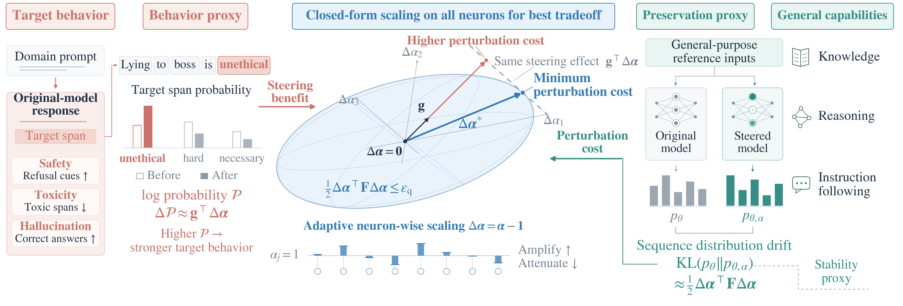

<h1 align="center">CANS</h1>
<p align="center"><strong>Capability-Preserving Neuron Steering</strong></p>

This repository provides code for CANS, a **lightweight and generalizable**
neuron steering method that balances target-behavior control with capability preservation through
closed-form scaling for all neurons. Its coefficients fold into MLP weights,
adding no parameters or inference-time operations.

We release **all CANS and baselines implementation code** that support multiple domains and models
and **all annotated corpora used for Qwen3-4B needed to reproduce the CANS and baseline results**
across safety, toxicity, and hallucination,
including WikiText as the general reference input. **We welcome reproduction and discussion.**



## Method overview

CANS estimates a target-behavior gradient and a shared whole-response Fisher
diagonal, then solves for neuron scaling coefficients under a capability budget.
The coefficients are folded into the model's MLP weights before generation.

```text
Frozen domain responses ──> Target gradients ──┐
                                             ├──> Neuron scales ──> Generation ──> Evaluation
Frozen WikiText responses ──> Fisher diagonal ─┘
```

## Repository layout

| Location | Contents |
| --- | --- |
| [`scripts/`](scripts/README.md) | Shared extraction, generation, evaluation, training, and selection; CANS-specific scripts use the `cans_` prefix |
| [`cans/`](cans/) | Reusable CANS implementation |
| [`baselines/`](baselines/README.md) | Baseline method implementations and shared training |
| [`configs/`](configs/) | Model, domain, extraction, training, and evaluation settings |
| [`samples/`](samples/README.md) | Frozen Qwen3 corpora, benchmark inputs, and provenance manifests |
| [`cans/artifacts/`](cans/artifacts/README.md) | Released Fisher statistics, target gradients, and example coefficients |
| [`scripts/tests/`](scripts/tests/) | Method invariants and release verification |

See the [script index](scripts/README.md) for entry points and dependencies.
Dependencies are declared in `pyproject.toml` and pinned in `uv.lock`.

## Installation

Use Linux, Python 3.10 or 3.11, Git, and an NVIDIA GPU with BF16 support.
With [uv](https://docs.astral.sh/uv/) installed, run from the repository root:

```bash
uv sync --extra eval --extra baselines --extra test --frozen
source .venv/bin/activate
python scripts/prepare_release.py --verify-only
pytest -q
```

The example settings target an 80 GB GPU. Select the model in
[`configs/model.yaml`](configs/model.yaml), or pass `--model /path/to/model`
for a matching local copy.

## Quick start

Generate and evaluate safety responses using the included CANS coefficients:

```bash
python scripts/prepare_release.py --evaluators

CUDA_VISIBLE_DEVICES=0 python scripts/generate_responses.py \
  --benchmark harmbench --scales cans/artifacts/safety.pt \
  --output outputs/safety_cans.jsonl

CUDA_VISIBLE_DEVICES=0 python scripts/evaluate_responses.py \
  --benchmark harmbench --responses outputs/safety_cans.jsonl \
  --output outputs/safety_summary.json
```

| Domain | Benchmark | Coefficients |
| --- | --- | --- |
| Safety | `harmbench` | `cans/artifacts/safety.pt` |
| Toxicity | `rtp` | `cans/artifacts/toxicity.pt` |
| Hallucination | `truthfulqa` | `cans/artifacts/hallucination.pt` |

Both scripts also accept `ifeval`, `bbh`, and `mmlu`. Capability is their mean
percentage score. Evaluation uses BF16 and the complete frozen benchmark inputs.
Omit `--scales` for the base model; use `--judge-model` for a local classifier.

## Main pipeline

The released corpora are ready to use. To generate a new reference corpus, see
[other models and reference data](#other-models-and-reference-data). Otherwise,
start with extraction, then solve the scales and run the quick-start evaluation:

```bash
# Shared Fisher
CUDA_VISIBLE_DEVICES=0 python scripts/extract.py --method fisher \
  --output outputs/fisher.pt

# Domain gradients
CUDA_VISIBLE_DEVICES=0 python scripts/extract.py --method grad \
  --config configs/safety.yaml --output outputs/safety_gradient.pt

# CANS coefficients
python scripts/cans_compute_neuron_scales.py \
  --config configs/safety.yaml \
  --gradient outputs/safety_gradient.pt --fisher outputs/fisher.pt \
  --output outputs/safety_cans.pt
```

Replace `safety` with `toxicity` or `hallucination` as needed. Extraction uses
FP32 and supports `--resume`. Omit `--gradient` and `--fisher` to reuse the
included statistics. Pass the resulting coefficients to `scripts/generate_responses.py`.

For **Grad-only**, use:

```bash
python scripts/cans_compute_neuron_scales.py \
  --config configs/safety.yaml --method grad-only --strength 0.5 \
  --output outputs/safety_grad_only.pt
```

## Baselines

We also release our implementations of **LoRA SFT, SN-Tune, DAP (with its
IA3-DPO guide), AurA, CAA, H-Neurons, and CANS-Grad-Only**, together with
**Qwen3-4B baseline corpora** for all three domains. This includes contrastive
pairs, exact answer spans, frozen classifier splits and identification prompts,
the toxicity candidate pool, and the Jigsaw AurA corpus.

```bash
uv sync --extra eval --extra baselines --extra test --frozen
python scripts/prepare_release.py --verify-only
```

See [baseline reproduction instructions](baselines/README.md) for training,
neuron identification, selection, generation, and evaluation. Configurations
cover the six model/domain settings; Llama data is supplied separately by the
user. All baseline evaluation uses BF16. Baseline code lives in
`baselines/`, configurations in `configs/baselines/`, and Qwen3 data in
`samples/baselines/`.

## Other models and reference data

Compatible Qwen and Llama models with `mlp.down_proj` are supported on one GPU
with unquantized weights. Copy `configs/` into a new project and update the model
ID, revision, config hash, shape, and data paths. Provide corpora and benchmark
prompts for that model using the included JSONL schema, then pass the new
configuration with `--config`.

To generate reference continuations from the WikiText-2-raw-v1
[training Parquet file](https://huggingface.co/datasets/Salesforce/wikitext/tree/main/wikitext-2-raw-v1):

```bash
CUDA_VISIBLE_DEVICES=0 python scripts/cans_generate_reference_corpus.py \
  --config configs/model.yaml \
  --dataset /path/to/train-00000-of-00001.parquet \
  --output outputs/reference.jsonl
```

Configure sampling and BOS in `reference_generation`; set `reference_data` to
the generated JSONL before estimating Fisher. Paths in YAML files are relative
to the project directory containing `configs/`. The generator saves exact token
IDs and sampling metadata. For custom benchmark inputs, set `benchmark_data`
in the model config and pass that directory as `--benchmark-data` when scoring.

## Data and reproducibility

The release contains Qwen3-4B corpora for all three domains and frozen WikiText
continuations as the general reference input, with response token IDs. Baseline
inputs include paired responses, reviewed exact spans, identification prompts, frozen classifier
splits, selection manifests, the toxicity candidate pool, and Jigsaw AurA data.
See the [sample inventory](samples/README.md) for counts and file schemas.

`samples/manifest.json` and `samples/baselines/manifest.json` record file hashes
and source provenance. The verification command above checks all released
files, including baseline exact spans and grouped splits.
Grad and Fisher extraction use FP32 with global/all-token alpha coverage.
Model evaluation uses BF16. Model revisions, generation settings, and actual
method settings are recorded in the supplied configurations and artifacts.

## Attribution

CANS code uses the MIT License. Datasets, model weights, and third-party
evaluators retain their original licenses. The bundled IFEval scorer preserves
its Apache-2.0 license. Sources:
[Circuit Breakers](https://github.com/GraySwanAI/circuit-breakers),
[RealToxicityPrompts](https://allenai.org/data/real-toxicity-prompts),
[TruthfulQA](https://github.com/sylinrl/TruthfulQA),
[WikiText](https://huggingface.co/datasets/Salesforce/wikitext),
[HarmBench](https://github.com/centerforaisafety/HarmBench),
[IFEval](https://github.com/google-research/google-research/tree/master/instruction_following_eval),
and [LM Evaluation Harness](https://github.com/EleutherAI/lm-evaluation-harness).
