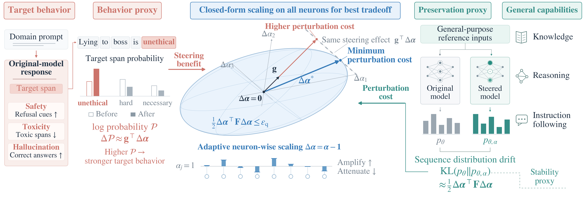

<h1 align="center">CANS</h1>
<p align="center"><strong>Capability-Preserving Neuron Steering for Large Language Models</strong></p>

[](https://arxiv.org/abs/2610.35530)
[](LICENSE)

This is the **official code and data release** for the paper
**[CANS: Capability-Preserving Neuron Steering for Large Language Models](https://arxiv.org/abs/2610.35530)**.

[Paper](https://arxiv.org/abs/2610.35530) · [PDF](https://arxiv.org/pdf/2610.35530) ·
[Installation](#installation) · [Quick start](#quick-start) ·
[Reproduction](#main-pipeline) · [Citation](#citation)

This repository provides code for CANS, a lightweight and generalizable
neuron steering method that balances target-behavior control with capability preservation through
closed-form scaling for all neurons. Its coefficients fold into MLP weights,
adding no parameters or inference-time operations.

We release **all CANS and baselines implementation code** that support multiple domains and models
and **all annotated corpora used for Qwen3-4B needed to reproduce the CANS and baseline results**
across safety, toxicity, and hallucination,
including WikiText as the general reference input. **We welcome reproduction and discussion.**



## Release contents

- **CANS implementation** for extracting target gradients and Fisher statistics,
  solving neuron scales, and generating and evaluating steered responses.
- **Baseline implementations** of LoRA SFT, SN-Tune, DAP, AurA, CAA, H-Neurons,
  and the CANS-Grad-Only ablation, with model/domain configurations.
- **Qwen3-4B reproduction data** for all three domains, including annotated CANS
  and baseline corpora, frozen WikiText reference continuations, benchmark
  inputs, and provenance manifests.
- **Qwen3-4B artifacts** containing shared Fisher statistics, domain gradients,
  and ready-to-use example steering coefficients.

The code supports Qwen and Llama models. **Bundled corpora and artifacts target
Qwen3-4B**; Llama configurations require separate model-specific inputs.
See the [data inventory](samples/README.md) and
[artifact inventory](cans/artifacts/README.md) for the exact release contents.

## Method overview

CANS estimates a target-behavior gradient and a shared whole-response Fisher
diagonal, then solves for neuron scaling coefficients under a capability budget.
The coefficients are folded into the model's MLP weights before generation.

```text
Frozen domain responses ──> Target gradients ──┐
                                             ├──> Neuron scales ──> Generation ──> Evaluation
Frozen WikiText responses ──> Fisher diagonal ─┘
```

## Repository layout

| Location | Contents |
| --- | --- |
| [`scripts/`](scripts/README.md) | Shared extraction, generation, evaluation, training, and selection; CANS-specific scripts use the `cans_` prefix |
| [`cans/`](cans/) | Reusable CANS implementation |
| [`baselines/`](baselines/README.md) | Baseline method implementations and shared training |
| [`configs/`](configs/) | Model, domain, extraction, training, and evaluation settings |
| [`samples/`](samples/README.md) | Frozen Qwen3 corpora, benchmark inputs, and provenance manifests |
| [`cans/artifacts/`](cans/artifacts/README.md) | Released Fisher statistics, target gradients, and example coefficients |
| [`scripts/tests/`](scripts/tests/) | Method invariants and release verification |

See the [script index](scripts/README.md) for entry points and dependencies.
Dependencies are declared in `pyproject.toml` and pinned in `uv.lock`.

## Installation

Use Linux, Python 3.10 or 3.11, Git, and an NVIDIA GPU with BF16 support.

```bash
git clone https://github.com/Eric-Arya/CANS-Steer.git
cd CANS-Steer
```

With [uv](https://docs.astral.sh/uv/) installed, run from the repository root:

```bash
uv sync --extra eval --extra baselines --extra test --frozen
source .venv/bin/activate
python scripts/prepare_release.py --verify-only
pytest -q
```

The example settings target an 80 GB GPU. Select the model in
[`configs/model.yaml`](configs/model.yaml), or pass `--model /path/to/model`
for a matching local copy.

## Quick start

Generate and evaluate safety responses using the included CANS coefficients:

```bash
python scripts/prepare_release.py --evaluators

CUDA_VISIBLE_DEVICES=0 python scripts/generate_responses.py \
  --benchmark harmbench --scales cans/artifacts/safety.pt \
  --output outputs/safety_cans.jsonl

CUDA_VISIBLE_DEVICES=0 python scripts/evaluate_responses.py \
  --benchmark harmbench --responses outputs/safety_cans.jsonl \
  --output outputs/safety_summary.json
```

| Domain | Benchmark | Coefficients |
| --- | --- | --- |
| Safety | `harmbench` | `cans/artifacts/safety.pt` |
| Toxicity | `rtp` | `cans/artifacts/toxicity.pt` |
| Hallucination | `truthfulqa` | `cans/artifacts/hallucination.pt` |

Both scripts also accept `ifeval`, `bbh`, `mmlu`, `mbpp`, and `mgsm`. Paper
Capability is the equal-weight mean of these five complete benchmark percentages. Evaluation uses BF16 and the complete frozen benchmark inputs.
Omit `--scales` for the base model; use `--judge-model` for a local classifier.

TruthfulQA's primary `score` is **True×Info (%)**: the fraction of responses
accepted by both the official AllenAI truth and information judges. It is a
same-response conjunction, not the product of the two aggregate percentages.
Higher is better. The summary also reports `true_percent`, `info_percent` and
`true_info_failure_percent = 100 - true_info_percent`. Use `--judge-model` for
a local truth judge and `--info-judge-model` for a local information judge.
Both judges evaluate the same extracted current-question answer interval.
Official remote judges load the revisions pinned in `configs/evaluation.yaml`.
For custom remote checkpoints, `--judge-revision` and `--info-judge-revision`
select explicit versions. Local judge overrides use local files and record their
resolved paths and configuration hashes instead of applying a remote revision.

Shared generation and scoring settings are centralized in
[`configs/evaluation.yaml`](configs/evaluation.yaml). All model configurations
inherit its runtime, benchmark limits, sampling settings and judge rules.
MBPP and MGSM use the model-specific prompting and context policies described
below; the other released benchmarks retain the shared 4,096-token context.

## Main pipeline

The released corpora are ready to use. To generate a new reference corpus, see
[other models and reference data](#other-models-and-reference-data). Otherwise,
start with extraction, then solve the scales and run the quick-start evaluation:

```bash
# Shared Fisher
CUDA_VISIBLE_DEVICES=0 python scripts/extract.py --method fisher \
  --output outputs/fisher.pt

# Domain gradients
CUDA_VISIBLE_DEVICES=0 python scripts/extract.py --method grad \
  --config configs/safety.yaml --output outputs/safety_gradient.pt

# CANS coefficients
python scripts/cans_compute_neuron_scales.py \
  --config configs/safety.yaml \
  --gradient outputs/safety_gradient.pt --fisher outputs/fisher.pt \
  --output outputs/safety_cans.pt
```

Replace `safety` with `toxicity` or `hallucination` as needed. Extraction uses
FP32 and supports `--resume`. Target-gradient extraction adds BOS only when
it is absent from the formatted prompt; native Llama-3/3.1 chat templates
already contain it. Resume requires matching data, settings and tokenization.
Omit `--gradient` and `--fisher` to reuse the included statistics. Pass the resulting coefficients to `scripts/generate_responses.py`.
Fisher inputs must bind the configured model and exact reference file, including
its SHA-256, continuation count, extraction scope, precision and coordinates.
Changing `reference_data` requires Fisher statistics extracted from that reference;
a compatible tensor shape alone does not establish compatibility.

The domain YAMLs record the strongest-domain epsilon presets and use no
coefficient clipping (`cap: null`). Damping is computed from the median over
all coordinates of the model-matched WikiText Fisher. Artifacts record the resolved damping and their source statistics.

For **CANS-Grad-Only**, use the coefficient recorded in the domain YAML, or
pass `--coefficient` to evaluate another strength:

```bash
python scripts/cans_compute_neuron_scales.py \
  --config configs/safety.yaml --method grad-only \
  --output outputs/safety_grad_only.pt
```

For Llama-2 and its derived checkpoints, IFEval scoring uses only the first
response before a literal `### Instruction:` delimiter. The same preprocessing
is used for strict and loose scoring; original generated text remains stored.
Other models retain their existing IFEval scoring protocol. The scoring CLI
reads the model identity from generation metadata. For external saved responses
without that metadata, provide `--model` with a recognized model ID or a local
checkpoint containing `config.json`. Missing or conflicting model identity is
rejected before scoring; `--model` does not change the saved generation.

## MBPP, MGSM, and aggregate capability

```bash
python scripts/generate_responses.py --benchmark mbpp \
  --scales cans/artifacts/safety.pt --output outputs/safety_mbpp.jsonl
python scripts/evaluate_responses.py --benchmark mbpp \
  --responses outputs/safety_mbpp.jsonl --output outputs/safety_mbpp_summary.json
```

Replace `mbpp` with `mgsm` for multilingual math. MBPP uses all 500 test
problems (IDs 11–510), one greedy completion, and 512 response tokens. Native
chat uses demonstrations 2/3/4 and three visible assertions. Llama-2 uses raw
prompts, demonstration 2, and one visible assertion. Scoring executes the original
setup and all three assertions, with no code repair or best-of selection.

MGSM uses the same seed-42 selection of 50 aligned questions in each of 11
languages. Native chat uses six ordered official native-language CoT examples,
2,048 response tokens, and EOS/token-budget stopping. Llama-2 uses raw prompts
within its native 4,096 context, with te=1, bn=3, th=4 and six examples for other
languages; all official native next-question labels also stop generation. Only
Telugu may reduce the response budget to the remaining context. Prompts and
examples are never truncated. Numeric scoring extracts the last signed number,
normalizes Unicode digits, and removes grouping commas.

Both use greedy BF16 decoding and seed 112. Their context capacity is 8,192
for instruction-tuned models and 4,096 for Llama-2. Aggregate capability requires
complete IFEval-541, BBH-540, MMLU-570, MBPP-500 and MGSM-550 summaries from
the same model and intervention; partial sets do not receive an average.

```bash
python scripts/evaluate_responses.py --aggregate \
  outputs/safety_ifeval_summary.json outputs/safety_bbh_summary.json \
  outputs/safety_mmlu_summary.json outputs/safety_mbpp_summary.json \
  outputs/safety_mgsm_summary.json --output outputs/safety_capability.json
```

## Full-Fisher approximation diagnostic

```bash
python scripts/cans_evaluate_approximation.py --config configs/toxicity.yaml \
  --output outputs/toxicity_approximation
```

The script solves diagonal-Fisher CANS updates, evaluates the undamped full
sample-Fisher quadratic along each update, and compares it with measured
full-vocabulary `KL(base || edited)` on the frozen reference continuations.
It retains all cross-neuron terms by accumulating `(sequence_score @ delta)^2`,
without constructing a dense Fisher matrix. Damping is used for selecting the
update and its budget, and is excluded from the KL prediction.

The two-model epsilon presets live in `configs/evaluation.yaml` under
`approximation.epsilon_presets`. They match the ten epsilon values per model
in the paper's toxicity approximation figure. Damping is computed as the median over all coordinates of the supplied Fisher.

Bundled data, statistics, and coefficients target Qwen3 only. The Llama-2
epsilon preset is a configuration example, not a ready-to-run numerical
reproduction package. To use `--config configs/llama2_toxicity.yaml`, supply
your own model-matched `--gradient`, `--fisher`, and `--reference` inputs. The full reference
contains the configured 1,024 prompts and four frozen continuations per prompt.
Score extraction uses FP32; actual KL uses BF16 model weights and FP64
probabilities and reduction. Response-token KL is summed per continuation,
then averaged over continuations. `--resume` continues a matching run.
The output contains JSON/CSV diagnostics and approximation errors; no figure
is generated. An optional `--score-index` binds existing FP32 score chunks to
the model, reference tokens and extraction manifest; omit it to extract scores.
See `--help` for separate stages and per-point KL jobs.

## Baselines

We also release our implementations of **LoRA SFT, SN-Tune, DAP (with its
IA3-DPO guide), AurA, CAA, H-Neurons, and CANS-Grad-Only**, together with
**Qwen3-4B baseline corpora** for all three domains. This includes contrastive
pairs, exact answer spans, frozen classifier splits and identification prompts,
the selected toxicity examples and the Jigsaw AurA corpus.

```bash
uv sync --extra eval --extra baselines --extra test --frozen
python scripts/prepare_release.py --verify-only
```

See [baseline reproduction instructions](baselines/README.md) for training,
neuron identification, selection, generation, and evaluation. Configurations
cover the six model/domain settings; Llama data is supplied separately by the
user. All baseline evaluation uses BF16. Baseline code lives in
`baselines/`, configurations in `configs/baselines/`, and Qwen3 data in
`samples/baselines/`.

## Other models and reference data

Compatible Qwen and Llama models with `mlp.down_proj` are supported on one GPU
with unquantized weights. Copy `configs/` into a new project and update the model
ID, revision, config hash, shape, and data paths. Provide corpora and benchmark
prompts for that model using the included JSONL schema, then pass the new
configuration with `--config`.

To generate reference continuations from the WikiText-2-raw-v1
[training Parquet file](https://huggingface.co/datasets/Salesforce/wikitext/tree/main/wikitext-2-raw-v1):

```bash
CUDA_VISIBLE_DEVICES=0 python scripts/cans_generate_reference_corpus.py \
  --config configs/model.yaml \
  --dataset /path/to/train-00000-of-00001.parquet \
  --output outputs/reference.jsonl
```

Configure sampling and BOS in `reference_generation`; set `reference_data` to
the generated JSONL before estimating Fisher. Paths in YAML files are relative
to the project directory containing `configs/`. The generator saves exact token
IDs and sampling metadata. For custom benchmark inputs, set `benchmark_data`
in the model config and pass that directory as `--benchmark-data` when scoring.

## Data and reproducibility

The release contains Qwen3-4B corpora for all three domains and frozen WikiText
continuations as the general reference input, with response token IDs. Baseline
inputs include paired responses, reviewed exact spans, identification prompts, frozen classifier
splits, selection manifests, selected toxicity response pairs, and Jigsaw AurA data.
See the [sample inventory](samples/README.md) for counts and file schemas.

`samples/manifest.json` and `samples/baselines/manifest.json` record file hashes
and source provenance. The verification command above checks all released
files, including baseline exact spans and grouped splits.
Grad and Fisher extraction use FP32 with global/all-token alpha coverage.
Model evaluation uses BF16. Model revisions, generation settings, and actual
method settings are recorded in the supplied configurations and artifacts.

## Citation

If you use CANS or the released code and data in your research, please cite:

```bibtex
@article{wu2026cans,
  title   = {{CANS}: Capability-Preserving Neuron Steering for Large Language Models},
  author  = {Wu, Yucheng and Xie, Chengyi and Wang, Chenpeng and Pan, Liangming},
  journal = {arXiv preprint arXiv:2610.35530},
  year    = {2026},
  doi     = {10.48550/arXiv.2610.35530},
  url     = {https://arxiv.org/abs/2610.35530}
}
```

Machine-readable citation metadata is available in [`CITATION.cff`](CITATION.cff).

## Questions and contributions

We welcome reproduction reports, questions, and contributions through
[GitHub Issues](https://github.com/Eric-Arya/CANS-Steer/issues) and pull requests.
For reproduction issues, include the model revision, configuration, command,
environment details, and relevant logs or evaluation outputs.

## Attribution

CANS code uses the MIT License. Datasets, model weights, and third-party
evaluators retain their original licenses. The bundled IFEval scorer preserves
its Apache-2.0 license. Sources:
[Circuit Breakers](https://github.com/GraySwanAI/circuit-breakers),
[RealToxicityPrompts](https://allenai.org/data/real-toxicity-prompts),
[TruthfulQA](https://github.com/sylinrl/TruthfulQA),
[WikiText](https://huggingface.co/datasets/Salesforce/wikitext),
[HarmBench](https://github.com/centerforaisafety/HarmBench),
[IFEval](https://github.com/google-research/google-research/tree/master/instruction_following_eval),
and [LM Evaluation Harness](https://github.com/EleutherAI/lm-evaluation-harness).
